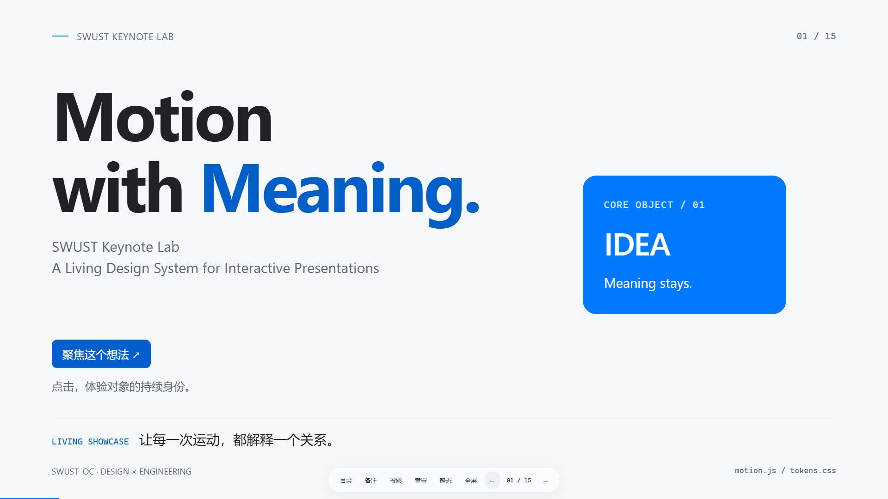
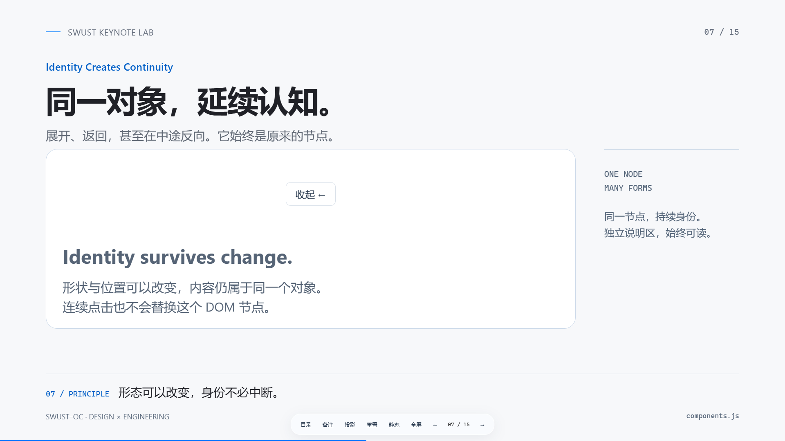
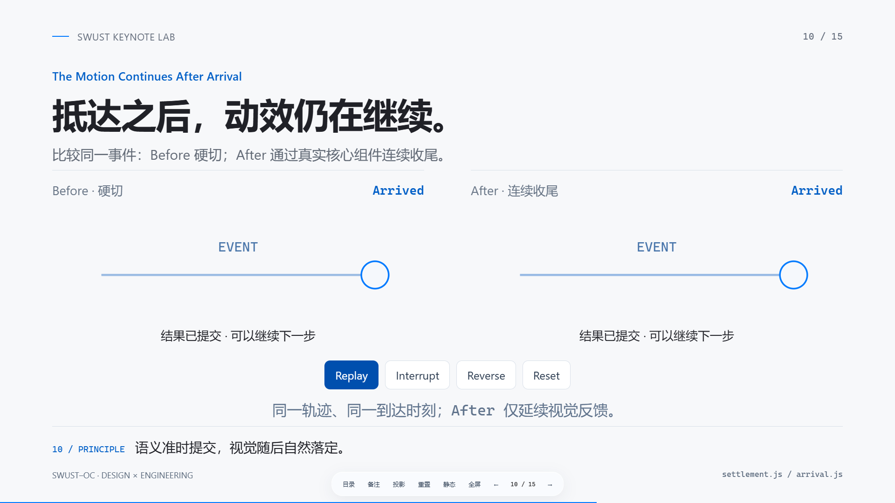

# swust-apple-keynote

**Turn technical ideas into interactive, offline HTML presentations.**

A reusable agent Skill with an Apple Keynote-inspired visual language: confident typography, generous space, restrained glass, and motion that explains relationships. It combines content planning, editable native web sources, a stateful animation runtime, and browser quality checks. The first public version is **v1.0.0**; earlier development labels were private iterations, not GitHub releases.

[简体中文](README.zh-CN.md) · [Showcase](dist/swust-keynote-showcase.html) · [Motion playground](dist/motion-playground.html) · [License](LICENSE)

## See the real Showcase

These are browser captures of the rebuilt v1.0.0 offline Showcase, not mockups. Download or clone the repository and open the HTML locally; GitHub's source viewer does not run it.





The 15-scene [Living Showcase](dist/swust-keynote-showcase.html) lets you drag springs, reverse SVG paths, interrupt transitions, compare authored timing, and inspect result feedback. [Glass Material Lab](dist/glass-material-lab.html) separates stable frosted glass from experimental optics. [Inside a Git Commit](dist/inside-a-git-commit.html) is an illustrative teaching demo, not a Git client.

## Core capabilities

- **Content-first composition.** Storyboard goals, facts, primary objects and content relationships before choosing layouts. The Showcase is a demonstration, not a mandatory template.
- **Continuity with meaning.** Persistent shared DOM objects, semantic scene recipes, Bézier timing and interruptible springs that retain velocity when retargeted.
- **Complete state changes.** Commit protocol or application state at the correct event; crossfade replacement text and interpolate line/color emphasis through visual settlement. Reset and reduced motion finish immediately.
- **Useful interaction.** SVG path tracing, bounded state machines, draggable objects, segmented controls, expandable capsules, notes and keyboard navigation.
- **Portable delivery.** Editable HTML/CSS/JS/SVG plus a bundled single HTML. No network, remote fonts, framework or runtime package installation is required to view the built decks.
- **Explainable verification.** A generic browser gate checks contrast, text, geometry, interruption, accessibility and rendering behavior. PASS, FAIL, REVIEW, SKIP and ERROR retain distinct meanings.

## Install

Clone the repository **directly into the Skill directory**. Replace `YOUR_GITHUB_OWNER` with the owner of the repository after it is published:

```sh
git clone https://github.com/YOUR_GITHUB_OWNER/swust-apple-keynote.git .agents/skills/swust-apple-keynote
```

The root `SKILL.md` must end up at `.agents/skills/swust-apple-keynote/SKILL.md`; no wrapper directory is needed. Alternatively, extract `swust-apple-keynote-v1.0.0-slim.zip` into `.agents/skills/`. The ZIP contains exactly one top-level `swust-apple-keynote/` directory. It includes all sources, four offline demos, these screenshots, documentation and tests; no browser binaries or development dependencies are bundled.

Use a Skill-capable coding agent that reads `SKILL.md`. This repository does not install a plugin or change global agent settings.

## Use

Example prompt:

> Use $swust-apple-keynote to create a five-slide Chinese presentation about the TCP three-way handshake. Keep Client and Server continuous across slides, animate SYN / SYN-ACK / ACK with SVG paths, and add Next / Previous / Reset. Show TCP states at the correct protocol events, support offline playback and reduced motion, and validate the built HTML in a browser.

For a product walkthrough:

> Use $swust-apple-keynote to explain this product to first-time users in six minutes. Build the story around one persistent object. Use interaction only where it clarifies a decision; include speaker notes and an offline sharing file.

Or scaffold manually (Python 3.10+):

```sh
python -B .agents/skills/swust-apple-keynote/scripts/scaffold.py my-talk
# Edit storyboard.json, slides.js, notes.js and custom.css in my-talk.
python -B .agents/skills/swust-apple-keynote/scripts/build.py my-talk/index.html my-talk/share.html
```

Open `my-talk/share.html` locally. Default canvas: 1920×1080, scaled equally. Arrow keys / Space navigate, T opens the directory, N notes, P projection note lock, F fullscreen, R resets the current interaction, B toggles static mode. Focused components own their relevant keys first.

## Development and validation

Viewing `dist/*.html` requires only a modern browser. Building uses Python's standard library. Skill checks additionally use PyYAML and Node.js; browser checks use Playwright and an installed Chrome channel. PNG comparisons use pngjs. Tested tool versions are pinned in `requirements-dev.txt` and `package.json`; install them in your own environment:

```sh
python -m pip install -r requirements-dev.txt
npm install
# Install Google Chrome separately, or use a supported installed browser channel.
python -B scripts/validate-skill.py .
python -B scripts/build-all.py
node scripts/validate-browser.cjs --input dist/swust-keynote-showcase.html --report qa/showcase-quality.json --channel chrome --modules node_modules
```

The full [validation protocol](references/validation.md) and [contribution guide](CONTRIBUTING.md) cover component regressions, seeded detector cases and distribution verification. [Acceptance results](audit/ACCEPTANCE.md), [file manifest](audit/file-manifest.json), and [license audit](audit/LICENSE-AUDIT.md) describe this candidate's actual scope. Automated checks do not replace factual or visual judgment.

## Boundaries

This produces HTML presentations, not editable `.key` or `.pptx` files. An agent must still understand the topic and verify its facts. Terminal commands are displayed or copied, never executed by the deck. Ordinary external links remain optional links; their destinations are not embedded.

Stable Frosted glass is the practical default. SVG Optical and WebGL Advanced consume an explicit supplied image or canvas texture; they do not capture arbitrary DOM. Advanced optics remain **Experimental**, degrade to Frosted, and make no physical-accuracy or universal frame-rate claim. Chrome and limited Edge checks do not establish Safari/Firefox, projector GPU, screen-reader or subjective comfort guarantees. Uncertain composites and semantic quality stay REVIEW.

Apple, Keynote and other names are used descriptively. This is an independent project with no Apple affiliation or endorsement. SWUST is part of the project name; no institutional logo, endorsement or trademark rights are granted by the software license.

## Contribute and roadmap

Read [CONTRIBUTING.md](CONTRIBUTING.md) before proposing a change. Include a minimal reproduction, explain the content relationship, and supply browser evidence for changed behavior. Never add third-party material without its provenance and redistribution terms.

Planned directions, not promises: independent browser coverage; stronger composited-pixel contrast evidence; more domain examples with explicit factual review; touch/projector and assistive-technology validation; smaller optional distribution profiles. Keep the stable runtime and experimental materials clearly separated.

## License

Original code, authored documentation, diagrams and newly captured Showcase screenshots are available under the [MIT License](LICENSE), following the rights holder's authorization. Third-party tools and trademarks retain their own terms. React Bits components are **not distributed**. See [third-party notices](THIRD_PARTY_NOTICES.md) for the audit boundary and upstream research license.
