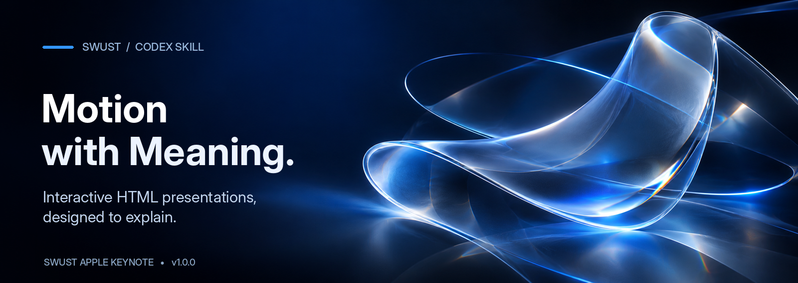
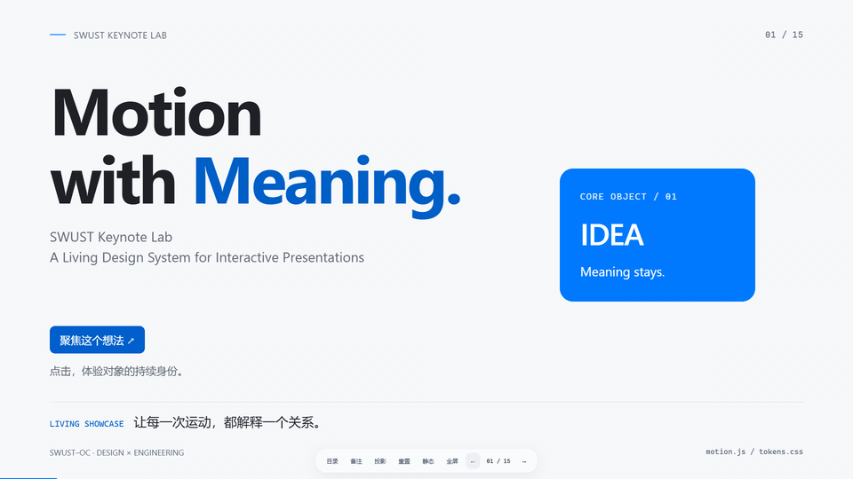
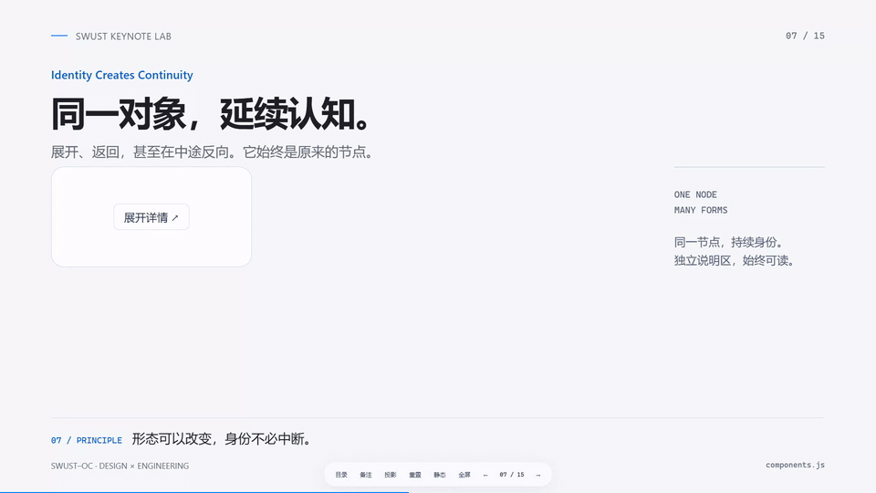
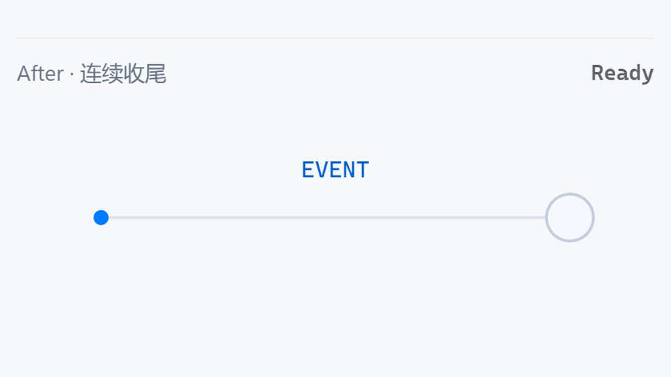

<p align="center">
  <a href="https://joucristian.github.io/SWUST-Apple-Keynote/">
    
  </a>
</p>

# SWUST Apple Keynote

用于制作交互式、可离线分享的 HTML 演示的 Codex Skill，让动效解释内容，并通过浏览器质量检查。

<p>
  <a href="https://github.com/JouCristian/SWUST-Apple-Keynote/releases/latest"></a>
  <a href="LICENSE"></a>
  
</p>

<p>
  <a href="https://joucristian.github.io/SWUST-Apple-Keynote/"></a>
  <a href="https://github.com/JouCristian/SWUST-Apple-Keynote/releases/latest"></a>
</p>

[English](README.md) &nbsp;·&nbsp; [Motion Playground](https://joucristian.github.io/SWUST-Apple-Keynote/motion-playground.html) &nbsp;·&nbsp; [Glass Material Lab](https://joucristian.github.io/SWUST-Apple-Keynote/glass-material-lab.html) &nbsp;·&nbsp; [Documentation](SKILL.md)

## 动态演示

三段真实 Chrome 交互录制。点击任意 GIF，直接体验对应页面。

<p align="center">
  <a href="https://joucristian.github.io/SWUST-Apple-Keynote/#1">
    
  </a>
  <br><strong>Introduction</strong><br>
  <sub>封面与想法聚焦</sub>
</p>

<table>
  <tr>
    <td width="50%" align="center">
      <a href="https://joucristian.github.io/SWUST-Apple-Keynote/#7">
        
      </a>
      <br><strong>Shared Element</strong><br>
      <sub>同一对象，展开再收回。</sub>
    </td>
    <td width="50%" align="center">
      <a href="https://joucristian.github.io/SWUST-Apple-Keynote/#10">
        
      </a>
      <br><strong>Result Settlement</strong><br>
      <sub>事件提交后，线条、箭头与文字连续收尾。</sub>
    </td>
  </tr>
</table>

## 在线体验

| 演示 | 体验 |
| :-- | :-- |
| **SWUST Keynote Lab** · 15 页交互式设计演示 | [体验 Showcase ↗](https://joucristian.github.io/SWUST-Apple-Keynote/) |
| **Motion Playground** · Spring、缓动、形变和路径绘制 | [打开 Playground ↗](https://joucristian.github.io/SWUST-Apple-Keynote/motion-playground.html) |
| **Glass Material Lab** · 磨砂、光学和实验性折射 | [探索 Glass Lab ↗](https://joucristian.github.io/SWUST-Apple-Keynote/glass-material-lab.html) |
| **Inside a Git Commit** · 交互式技术教学示例 | [打开 Git Demo ↗](https://joucristian.github.io/SWUST-Apple-Keynote/inside-a-git-commit.html) |

> **首个公开版本：v1.0.0。** 此前版本号仅属于内部迭代，不代表已发布的 GitHub Releases。

## 核心能力

- 先分析受众、事实与内容关系，编写 storyboard，再决定构图；不强制套用 Showcase 页面结构。
- 使用持久共享 DOM、语义镜头、Bézier 与保留速度的 Spring，让对象跨页连续且可中断。
- 逻辑状态在正确事件提交，随后线条颜色、强调和替换文字平滑收尾；Reset、静态及减少动态效果立即完成。
- 提供 SVG 一笔画、状态机、拖拽、分段控件、形变胶囊、讲者备注、键盘导航。
- 原生 HTML/CSS/JS/SVG 和系统字体；构建后的单 HTML 无需联网、框架或安装依赖。
- 通用浏览器质量门禁明确区分 PASS、FAIL、REVIEW、SKIP、ERROR，不把待审查内容说成自动通过。

## 安装

直接 clone 到项目的 Skill 路径：

```sh
git clone https://github.com/JouCristian/SWUST-Apple-Keynote.git .agents/skills/swust-apple-keynote
```

最终应存在 `.agents/skills/swust-apple-keynote/SKILL.md`。也可把 `swust-apple-keynote-v1.0.0-slim.zip` 解压到 `.agents/skills/`，ZIP 已包含单层 `swust-apple-keynote/`。不需要额外套一层仓库目录。

Skill 由支持读取 `SKILL.md` 的编程 Agent 使用，不修改全局配置。安装包包含源码、四个离线演示、截图、文档和测试，不包含浏览器、node_modules 或缓存。

## 使用示例

> 使用 $swust-apple-keynote，制作 5 页中文 TCP 三次握手教学。以 Client、Server 为连续对象，用 SVG 展示 SYN、SYN-ACK、ACK，提供 Next、Previous、Reset，在正确协议事件更新双方状态。支持离线和 prefers-reduced-motion，并对构建产物进行浏览器验收。

> 使用 $swust-apple-keynote，把产品说明整理成面向新用户的六分钟演示。围绕一个持久对象展开，交互只用于帮助理解决策，交付讲者备注和离线 HTML。

也可手动创建（Python 3.10+）：

```sh
python -B .agents/skills/swust-apple-keynote/scripts/scaffold.py my-talk
# 编辑 storyboard.json、slides.js、notes.js、custom.css
python -B .agents/skills/swust-apple-keynote/scripts/build.py my-talk/index.html my-talk/share.html
```

本地打开 `share.html`。默认 1920×1080 等比画布；方向键/Space 翻页，T 目录，N 备注，P 投影备注锁定，F 全屏，R 重置当前交互，B 静态模式。聚焦组件时其相关按键优先。

## 开发与验收

播放 dist HTML 只需现代浏览器，构建只用 Python 标准库。Skill 检查还需 PyYAML 与 Node.js；浏览器验收需 Playwright 和已安装 Chrome，像素检查需 pngjs。开发工具版本记录于 `requirements-dev.txt`、`package.json`，不会嵌入演示运行时。

```sh
python -m pip install -r requirements-dev.txt
npm install
python -B scripts/validate-skill.py .
python -B scripts/build-all.py
node scripts/validate-browser.cjs --input dist/swust-keynote-showcase.html --report qa/showcase-quality.json --channel chrome --modules node_modules
```

另行安装 Chrome。完整流程见[验收规范](references/validation.md)、[贡献指南](CONTRIBUTING.md)；当前结果见[验收记录](audit/ACCEPTANCE.md)、[实际文件清单](audit/file-manifest.json)和[许可证审计](audit/LICENSE-AUDIT.md)。自动化不能代替技术事实与人工视觉判断。

## 功能边界

产物为 HTML，不是可编辑 `.key` 或 `.pptx`。内容事实仍需核对；终端命令只展示或复制。外部普通链接不会被打包成离线页面。

Stable Frosted 是默认实用材质。SVG Optical 和 WebGL Advanced 只采样显式提供的图片或 Canvas，不自动采样任意 DOM；Advanced 为 **Experimental**，失败退化为 Frosted，不承诺物理光学精度或普遍 60fps。Chrome 与有限 Edge 检查不等于 Firefox/Safari、投影 GPU、读屏器或主观舒适度全面通过。不确定的背景对比度和语义质量保留 REVIEW。

本项目独立于 Apple，Apple/Keynote 名称仅用于描述风格；软件许可不授予商标、机构标识或背书权利。SWUST 为项目名称的一部分，不代表官方背书。

## 贡献与路线图

提交改动前阅读 [CONTRIBUTING.md](CONTRIBUTING.md)，提供最小复现、内容关系说明与对应浏览器证据。新增第三方素材必须记录来源及再分发许可。

后续方向：扩展独立浏览器覆盖、加强合成像素对比度证据、增加经过技术核对的领域示例、补充触摸/投影/辅助技术验收、按需提供更小的分发组合。这些是计划，不是已交付承诺。

## 许可证

权利人已确认有权公开授权原创代码，采用 [MIT](LICENSE)。原创文档、图形和本次新截图一并纳入授权；第三方工具与商标保留各自条款。未分发 React Bits 组件源码，详见[第三方说明](THIRD_PARTY_NOTICES.md)。
